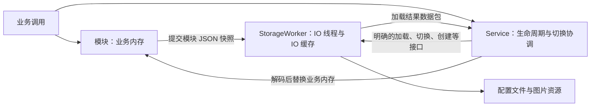

# 配置存储架构重新设计（待审阅）

本文从“两份缓存”划分职责，整体方案允许后续扩展模块。四字段图像参数的最小实现已按五批完成，具体完成范围见 [分批实现计划](implementation-plan.md)。本文件中其他模块、资源和跨版本迁移属于后续完整方案。

V0.4 的具体 JSON 字段定义见：[XS 配置文件 JSON 设计（V0.4）](config-json-v0.4.md)。

## 1. 核心结构

整个系统只有两份长期配置状态：

- **业务内存**：各模块持有自己的 C++ 配置对象，接收用户设置，为业务提供查询。
- **IO 缓存**：StorageWorker 的 IO 线程持有 JSON 快照，负责加载、合并修改、落盘和配置文件切换。

普通 getter 只访问业务内存和 Service 内部索引，不访问 IO 线程。普通 setter 修改业务内存后提交快照，不等待文件保存。加载、切换、创建、删除、重载和退出是同步操作，需要等待 IO 完成。

加载时传回的 JSON 数据包、入队的修改快照都是临时传输数据，不再建立第三份长期缓存。



## 2. 保留哪些类，各自负责什么

### XBotGoConfigService

系统入口，持有 Worker 和所有模块对象。

负责：

- 初始化、退出，以及创建、删除、重命名、切换、重载的流程协调。
- 将模块的存储位置在启动时告诉 Worker。
- 持有一份内部 `IndexState`，用于当前配置、配置列表和名称唯一性校验。
- 把加载结果交给各模块 Codec 解码，全部校验成功后统一替换业务内存。
- 控制切换期间的读写边界，避免新旧配置混用。
- 提供配置列表、当前配置 ID 和保存错误等查询。

不负责：打开文件、读写 JSON、拼接文件路径、维护 IO 缓存，也不通过 lambda 安排具体文件操作。外部只能通过 Service 的配置管理方法访问索引信息，不能直接修改索引 JSON。

### IndexState（Service 内部索引）

`XBotGoConfigService::Impl` 持有索引的结构化内存副本。它不是业务模块配置，也不是让外部直接操作的公共对象：

```cpp
struct ConfigurationEntry {
    std::string id;
    std::string name;
    std::string createdAt; // UTC ISO 8601，历史值无法确定时为空。
    // 后续可增加标签、描述、状态等索引元数据。
};

struct IndexState {
    int indexSchemaVersion = 1;
    int configurationVersion = 2;
    std::string currentConfigId;
    std::vector<ConfigurationEntry> configurations;
};
```

`ConfigurationEntry` 刻意保留为结构体，而不是使用 `id -> name` 的字符串 map。这样索引以后增加字段时，仍然由同一个配置条目承载；需要按 ID 查找时由 Service 建立临时查找逻辑即可，不把磁盘 JSON 的扩展空间限制在当前字段上。

磁盘上的 `index.json` 结构如下：

```json
{
  "index_schema_version": 1,
  "configuration_version": 4,
  "current_config_id": "550e8400-e29b-41d4-a716-446655440000",
  "configurations": {
    "550e8400-e29b-41d4-a716-446655440000": { "name": "默认配置" },
    "7f5032c4-f8d1-4f20-843d-d4f8feef04e8": { "name": "比赛配置" }
  }
}
```

Service 使用 `IndexState` 做快速判断，再请求 Worker 持久化结果：

- 创建前判断 ID 和名称是否重复。
- 重命名前判断目标名称是否已被其他配置占用；重复时直接拒绝，不提交 IO 操作。
- 删除前判断配置是否存在、是否为当前配置，以及删除后是否仍有可用配置。
- 切换前判断目标 ID 是否存在。
- 初始化和 Worker 成功加载/保存索引后，才替换 `IndexState`。

因此索引有两个明确形态：Service 的 `IndexState` 是管理操作使用的内存状态；Worker 的 IO 缓存保存其 JSON 快照并负责读写磁盘。两者不能由两个线程同时直接修改。所有变更由 Service 先校验并生成新的 `IndexState`，再通过 Worker 的索引接口保存；保存成功后 Service 才提交替换自己的索引。

### 各模块 ConfigImpl

例如 ImageParametersConfigImpl、BasketballConfigImpl。

负责：

- 自己的 C++ 配置数据、数据校验和模块锁。
- getter、setter 和业务变更通知。
- 把完整模块数据编码成 JSON，直接提交给 Worker。
- 接收 Service 提供的已解码数据，替换业务内存；这种替换不再次触发保存。

模块构造时直接接收 `StorageWorker &`，不再绑定保存回调、目录回调和路径解析回调。

模块只调用 `submitModule()`、`importAsset()`、`resolveAssetPath()` 等明确接口，不调用线程函数，也不知道 dirty、定时器、文件路径和 JSON 落盘过程。

模块不得调用配置切换、关闭等管理操作，这些由 Service 统一协调。Worker 不得反向调用模块对象。

### 各模块 Codec

保持为简单的转换工具，不持有配置状态。

- C++ 模块数据 → 完整模块 JSON。
- 模块 JSON → C++ 模块数据，并检查格式、处理字段默认值。

不读文件、不启动线程、不保存数据。Worker 不依赖 ImageParametersData、BasketballData 等业务类型。

### StorageWorker

配置系统唯一的文件 IO 入口。

负责：

- 标准 C++ IO 线程、任务队列和同步等待。
- index.json、主配置和独立模块文件的加载与保存；不暴露可被外部直接修改的索引对象。
- 当前配置的 IO 缓存、dirty 状态和延时落盘。
- 配置目录、备份恢复、配置文件切换、创建、删除与重命名。
- 资源导入，以及 JSON 保存成功后清理旧资源。
- 将操作结果、加载数据包和错误返回给调用方。

文件操作只能发生在 IO 线程；接口调用方不需要了解如何投递任务或等待条件变量。

### ConfigRepository 如何处理

当前 Repository 本来承担“配置目录和文件访问”的职责，但又直接接收图像、篮球等业务类型；Service 还要用 execute 包装它，Worker 又另外维护保存缓存，因此职责发生了分散。

**新方案删除 ConfigRepository 这一层，将其文件操作移入 StorageWorker 的私有实现。**

业务编码与解码回归 Codec；路径计算可以保留为 Worker 内部的普通辅助函数。暂不引入 Repository 接口、任务总线、模块基类或通用存储框架。

## 3. 存储位置由简单表描述

启动时提供固定的模块存储表即可：

| 模块 key | 存储方式 | 位置 |
| --- | --- | --- |
| image_parameters | 主配置节点 | mainConfig.image_parameters |
| basketball | 独立文件 | basketball.json |

Worker 根据表处理文件和节点，不根据业务类型写分支。新增模块时补一项描述和对应 Codec，不需要再给 Service 增加一组保存回调。

这是一张普通数据表，不做动态插件注册系统。

## 4. 加载结果：明确的数据包

按你的想法，加载结果包含 index、主配置和其他独立模块的 obs_data_t。索引部分仅用于 Service 更新内部 `IndexState`，不直接暴露给业务调用方。建议固定两个字段，加一张独立模块 map，比把所有对象混入同一个字符串 map 更容易看懂：

```cpp
// 示意类型；ObsData 是只管理 obs_data_t 引用释放的小型 RAII 包装。
struct LoadedConfiguration {
    std::string configId;
    ObsData index;
    ObsData mainConfig;
    std::unordered_map<std::string, ObsData> separateModules;
};
```

Service 收到 `LoadedConfiguration` 后，把 `index` 解码成临时 `IndexState`，通过全部校验后再替换自己的索引。外部接口如 `getConfigurations()` 只返回 `ConfigurationSummary` 数组副本。

例如：

```text
configId = "配置 A"
index = index.json 的完整 JSON
mainConfig = 主配置文件的完整 JSON
separateModules["basketball"] = basketball.json 的完整 JSON
```

- index 提供配置列表和当前选择等元数据，不是某个业务模块。
- 主配置保留完整对象，包括未知节点和独立模块的文件引用，不能只保留当前认识的模块。
- Service 从 mainConfig 取出 image_parameters，交给图像 Codec。
- Service 从 separateModules 取出 basketball，交给篮球 Codec。
- 未启用的模块不必解码，但其主配置节点应保留。

**加载返回的数据包和 IO 缓存不能共享可变 obs_data_t。** 增加引用计数不等于复制。跨线程交付时建立独立 JSON 副本；接收方只读取自己的副本，使用结束后自动释放。

## 5. StorageWorker 提供的明确接口

以下是职责级接口示意，最终参数形式可在实现时精简。普通业务不再使用 execute(lambda)。

| 接口 | 用途 | 调用是否等待 IO |
| --- | --- | --- |
| initialize(root, moduleLocations) | 启动线程，准备目录，读取/恢复索引，处理版本迁移；返回索引 JSON 副本 | 是 |
| loadConfiguration(configId) | 读取候选配置的完整数据包，尚不改变当前配置 | 是 |
| activateConfiguration(configId) | 将已加载候选配置设为当前配置，提交当前配置索引 | 是 |
| submitModule(moduleKey, snapshot, oldAssets) | 提交完整模块快照，由 Worker 分配修改版本号 | 只等待入队 |
| createConfiguration(configId, name, initialModules, nextIndex) | 按 Service 已校验的下一份索引创建完整配置并保存索引 | 是 |
| renameConfiguration(nextIndex) | 保存 Service 已校验的下一份索引 | 是 |
| removeConfiguration(configId, nextIndex) | 删除配置目录并保存 Service 已校验的下一份索引 | 是 |
| importAsset(sourcePath) | 将图片复制到当前配置资源目录，返回相对路径 | 是 |
| resolveAssetPath(relativePath) | 根据当前配置解析资源路径，不访问文件内容 | 否 |
| close() | 停止接收新任务，排空队列，保存，结束线程，返回保存结果 | 是 |

`loadConfiguration()` 开始前先保存当前配置的待写内容，因此也可用于重载当前配置。保存失败则不继续加载。

`loadConfiguration()` 在 IO 线程暂存一份候选配置；下一次加载替换该候选，加载失败则清空候选。`activateConfiguration()` 只允许激活最近一次成功加载的对应配置，成功后消耗候选。候选只是切换期间的临时数据。

为什么加载和激活分两步：IO 线程能检查文件及 JSON，但业务字段是否有效由 Codec 判断。先读、再校验、最后切换，才能保证某个模块校验失败时旧配置仍然完整可用。这里不需要让 Worker 接收业务校验回调。

Worker 内部保留私有 `flushInIoThread()`，供这些操作建立保存屏障。模块和外部业务不需要调用 flush，也不需要先手工调用 syncCache。

## 6. 两份缓存怎样交换数据

### 普通修改：业务内存 → IO 缓存

以修改球队名称为例：

1. setter 进入正常配置读写区，并取得模块锁。
2. 在临时 C++ 对象中修改并校验，编码出完整篮球 JSON 快照。
3. 调用 `worker.submitModule("basketball", snapshot, oldAssets)`。
4. Worker 接收入队后，模块提交自己的 C++ 内存修改，释放锁，再发出变更通知。
5. IO 线程按模块 key 合并快照，更新篮球文件缓存并标记 dirty。
6. 首次修改后一秒统一保存，新任务不重置截止时间。

若入队失败，setter 返回失败，业务内存不提交此次修改。入队成功只代表修改被接收，不代表已经保存到磁盘；后续落盘失败通过 Worker 的错误状态体现。

模块锁覆盖“生成快照、入队、提交业务内存”，防止同一模块的并发 setter 将旧快照排在新快照后面。Worker 在入队锁内分配全局自增 revision，不再同时维护模块自增版本和 Service 自增版本。

### 加载：IO 缓存 → 业务内存

1. Worker 在 IO 线程读取索引、完整主配置和各独立文件，生成候选缓存。
2. 返回候选的独立数据包副本。
3. Service 使用各模块 Codec 解码，先放入临时 C++ 对象；此时不修改模块现有内存。
4. 全部解码成功后，Service 请求 Worker 激活候选。
5. 激活成功后，Service 将准备好的 C++ 对象移入各模块；不再次编码并送回 Worker。

因此，**加载一次就同时建立 IO 缓存和业务内存，不再“读文件 → 业务解码 → 重新编码 → syncCache”绕一圈。**

## 7. 切换与并发边界

Service 和模块共用一把配置读写门锁，作为简单协调机制，不另建管理框架：

- 普通 getter/setter 持共享锁，模块内部再持自己的数据锁。
- Service 加载、切换、重载、删除、退出等管理流程持独占锁。
- 固定顺序：配置门锁 → 模块锁 → Worker 入队锁。
- IO 线程从不取得配置门锁、模块锁，也不调用业务对象。

这样切换会等待已经进入的 setter 完成入队；独占期间新 getter/setter 等待，无法读到只替换了一部分模块的状态。IO 等待不会与业务锁形成相互等待。

以 A 切换到 B 为例：

1. Service 取得独占门锁。
2. 调用 `loadConfiguration(B)`：IO 排空此前修改并保存 A，随后加载 B 为候选，返回数据包。
3. Service 解码 B 的全部模块。失败则返回错误，A 的业务内存和当前 IO 缓存不变。
4. Service 根据校验结果生成新的 `IndexState`，调用 `activateConfiguration(B, nextIndex)`；IO 先安全保存指向 B 的索引，成功后用已准备好的候选替换当前 IO 缓存。
5. Service 使用已解码对象替换所有模块内存，同时提交并替换自己的 `IndexState`。
6. 释放门锁后通知业务配置已切换。

第 5 步只做已经准备好的内存移动/交换，不再进行文件操作或可能返回业务校验失败的处理。信号在释放锁后发送，避免回调重入死锁。

索引保存失败时不执行第 5 步，A 继续可用。这里保证进程内切换的一致性，不引入多文件事务系统。

重载当前配置使用同样流程。读取前先保存待写修改；如果以后需要“丢弃未保存修改并强制读盘”，应作为单独的明确操作，不能混在重载语义里。

## 8. 内存状态和 IO 状态

业务内存只由各模块实现类持有；Service 只额外持有配置管理用的 `IndexState`，不复制图像参数或篮球数据。模块内部通过读写锁保护业务数据，setter 在模块写锁内生成完整快照、编码并提交，成功入队后再更新业务内存。配置管理操作通过共用门锁与 setter 互斥，避免快照属于错误的配置。

IO 线程只拥有文件相关状态。它不保存 `ImageParametersData`、`BasketballData` 等业务对象，也不调用模块方法：

```cpp
struct IoState {
    ObsData indexJson;
    std::string currentConfigId;
    ObsData mainConfigJson;
    bool mainConfigDirty = false;
    std::unordered_map<std::string, SeparateFileState> separateFiles;
    std::unordered_map<std::string, SaveTask> pendingTasks;
};
```

这里的 `ObsData` 是管理 `obs_data_t *` 所有权的内部 RAII 类型。业务线程和 IO 线程之间只传递独立快照：入队后由 Worker 接管快照所有权；加载返回的数据包与 IO 缓存使用不同的 JSON 副本，不能共享可变对象。

主配置缓存始终是完整 `config.json`。更新主配置模块时只替换对应节点，保存时写完整主配置。每个独立文件缓存保存该文件的完整 JSON、路径、revision、dirty 和待清理资源。

## 9. 保存队列

Worker 内部用一个保存队列和一个按 key 合并的待处理表：

```cpp
struct SaveTask {
    std::string configId;
    std::string moduleKey;
    ModuleStorageMode mode;
    std::uint64_t revision;
    ObsData data;
    std::vector<std::filesystem::path> deleteAfterSave;
};
std::unordered_map<std::string, SaveTask> pendingTasks;
```

任务 key 应由 `configId + moduleKey` 唯一确定，例如 `A/image_parameters`、`A/basketball`。同一个 key 再次提交时只保留 revision 较新的快照，同时合并两次的 `deleteAfterSave`。因此连续修改十次只处理最终快照，不逐个写入。

IO 线程从 pending 表交换一批任务，按存储模式更新 IO 缓存。第一项修改到达时设置一秒保存截止时间；后续任务只唤醒线程，不重新开始计时。到期后一次保存本批次所有 dirty 文件。

保存顺序固定为：处理任务、保存完整主配置、保存独立文件、确认所有相关 JSON 成功、清理旧资源、清除 dirty 并更新 saved revision。任一 JSON 保存失败时保留 dirty 和清理清单，不删除旧资源；`.tmp` 用于临时写入，`.bak` 保留恢复。

创建、删除、重命名、切换、重载和关闭都会先建立保存屏障，由 Worker 立即处理队列并保存，不对业务暴露 `flush()`。关闭时停止接收新任务，排空队列并报告最终保存结果。

## 10. 目录、版本和资源

建议目录布局如下。`configurations/` 下先按完整配置格式版本分目录，配置 ID 再作为具体配置目录名；两者都不使用可修改的显示名称：

```text
xbotgo/
├── index.json
└── configurations/
    ├── v1/
    │   └── <config-id>/
    │       ├── config.json
    │       ├── basketball.json
    │       └── assets/
    └── v4/
        └── <config-id>/
            ├── config.json
            ├── basketball.json
            └── assets/
```

`index_schema_version` 是 index 文件格式版本，`configuration_version` 是 `configurations/vN/` 的整套配置目录格式版本。两者与运行期 `revision` 分开。Worker 根据 `configuration_version` 选择配置根目录，例如版本 4 使用 `configurations/v4/`。启动时只支持从旧版本向当前版本迁移；遇到高于当前程序的版本不得覆盖或删除原文件。

代码中保留当前完整配置版本常量：

```cpp
inline constexpr int kCurrentConfigurationVersion = 4;
```

启动时比较 `index.configuration_version` 与该常量：低于当前版本则按 `v1 → v2 → ... → 当前版本` 逐版本迁移；相等时直接读取对应版本目录；高于当前版本时只报告不兼容并保持原目录不变。

图片只保存相对 `configurations/vN/<config-id>/` 当前配置目录的路径，Worker 负责复制到该目录的 `assets/` 并限制路径不能通过 `..` 穿透。新 JSON 保存成功后才删除旧图片，异常退出留下的 `.tmp` 可以清理，`.bak` 用于恢复。

## 11. 首次加载

首次初始化完整流程如下：

```text
启动 StorageWorker
  → 创建根目录和 configurations 目录
  → 读取 index.json，失败时尝试 index.json.bak
  → 校验 index 结构、版本和 current_config_id
  → 需要时在 IO 线程完成旧版本迁移
  → 没有可用 index 时扫描合法的 configurations/vN/<config-id>/ 目录，只恢复可确认的 ID 和版本
  → 将 index 解码为临时 IndexState
  → 选择 current_config_id 对应的配置；无效时按列表选择第一个有效配置
  → 读取该配置的完整 config.json 和所有已注册独立模块文件
  → 返回 LoadedConfiguration
```

如果没有任何有效配置，Service 使用模块默认数据生成完整初始 JSON，先构造包含新配置的下一份 `IndexState`，再调用 Worker 创建配置。只有配置文件和索引都保存成功后，才替换 Service 的 `IndexState` 和各模块业务内存。

高版本 index 或 `configurations/vN/` 目录不能被当前程序修改。迁移从旧版本目录读取，写入新的 `configurations/vCurrent/` 临时目录，重新加载校验成功并安全保存新 index 后，才删除旧版本目录；失败时保留旧版本。

迁移按完整配置版本执行，不按运行期模块 revision 执行。每个版本迁移负责整套文件布局的提交，各模块只提供自己的数据转换：

```cpp
struct MigrationData {
    ObsData mainConfig;
    std::unordered_map<std::string, ObsData> separateModules;
};

bool migrateV1ToV2(MigrationData &data, std::string &error);
```

如果模块从主配置节点改为独立文件，或从独立文件合并回主配置，必须提升完整配置版本，并在对应迁移步骤中完成文件搬迁。迁移先写入临时的 `configurations/vN/` 目录，重新加载并校验所有 JSON，保存新 index 后再原子地切换目录；不能直接覆盖旧版本文件。迁移失败时保留旧 index 和旧版本目录，当前进程使用默认内存配置或停止初始化，不能把半迁移结果作为可用配置。

如果 `index.json` 损坏，先尝试 `.bak`；仍无法恢复时扫描 `configurations/v*/`，选择不高于当前程序版本的最高版本目录重建索引。扫描只能可靠恢复配置 ID，显示名称缺失时使用不重复的默认名称。高于当前程序版本的目录不参与重建，也不删除。

## 12. 配置切换

切换必须同时更新业务内存、IO 缓存和索引中的 `current_config_id`，完整流程如下：

```text
Service 检查目标 ID 存在且不是当前配置
  → 取得配置独占门锁，暂停新的 setter
  → Worker 排空保存队列并保存当前配置
  → Worker 在 IO 线程加载目标配置为候选缓存
  → Service 解码并校验候选的全部模块到临时 C++ 对象
  → 校验失败：丢弃候选，保持当前配置不变
  → Service 生成 current_config_id 已更新的下一份 IndexState
  → Worker 保存新 index，并激活候选 IO 缓存
  → Service 一次性替换所有模块业务内存和 IndexState
  → 释放门锁，恢复 setter，发送切换完成通知
```

任何保存或加载步骤失败，都不能替换业务内存或 Service 索引。切换过程中 IO 线程不取得业务锁，也不反向调用模块；业务内存替换只使用已经校验成功的临时对象，不再触发普通保存回调。

## 13. IO 缓存和落盘规则

Worker 的长期 IO 状态只包括：

- 完整索引 JSON。
- 当前配置 ID。
- 一个完整主配置 JSON 及 dirty 状态。
- 按模块 key 保存的独立文件 JSON、dirty、revision 和待清理资源。
- 合并中的待处理快照。

未修改的文件跳过写入。主配置模块更新只替换对应节点，落盘时保存完整主配置；独立文件直接保存完整模块快照，不重新读取旧文件。

资源清理要求：

- 合并任务时合并旧资源清单，不能因丢弃旧快照而丢失清理请求。
- 本批次相关 JSON 保存成功后才删除旧图片。
- JSON 保存失败保留 dirty 和清理清单，延后重试。
- 图片由 Worker 生成唯一文件名，相对路径随模块 JSON 保存；失败留下的未引用图片可后续清理，不能提前删除仍被引用的旧图片。
- 资源路径必须限定在配置资源目录中，不能让模块提交任意文件删除请求。

保存使用 tmp/bak 安全写入，bak 用于恢复，不主动删除。退出保存失败要把错误返回给 Service，不能仅仅结束线程后报告成功。

revision 是运行期修改顺序，不是配置文件格式版本。每次成功入队递增一次，各模块共用一个计数器。若对外展示 savedRevision，应表示该版本及之前的修改均已成功保存，不能简单取某个成功文件的最大值来掩盖其他文件的保存失败。

## 14. 创建、删除和初始化的基本约定

- 创建：Service 先检查名称唯一性并生成下一份 `IndexState`，再提供完整初始模块 JSON 给 Worker。Worker 写配置文件和索引，成功后 Service 才替换自己的索引；失败不把半成品展示为可用配置。
- 删除：Service 先检查 ID、当前配置和剩余数量，生成移除该项后的 `IndexState`。当前配置不能直接删除，需要先成功切到另一份；随后 Worker 先保存新索引，再清理对应目录。目录清理失败报告错误并保留可重试信息，Service 不提交内存索引变更。
- 配置格式升级放在 Worker 初始化的 IO 流程中完成，与运行期 revision 分开。先保存新版本，再更新索引；成功前保留旧版本用于恢复。

## 15. 新旧方案的直接变化

| 现在的做法 | 新方案 |
| --- | --- |
| Service 用 execute(lambda) 调用 Repository | Service 调用 Worker 明确的加载、创建、激活等接口 |
| Repository 同时读文件、解码图像和篮球数据 | Worker 读文件，Codec 解码业务数据 |
| 模块绑定一组保存和资源路径回调 | 模块直接持有 Worker 引用 |
| 读盘后重新编码，再 syncCache | 读盘直接建立 IO 候选缓存，返回副本建立业务内存 |
| 文件路径和 IO 操作分散在多处 | 所有文件操作集中在 Worker |
| 调用层自行安排同步等待和保存顺序 | Worker 接口内部完成队列屏障和等待 |

实现范围控制在 Service、模块、Codec、Worker 四类职责内。优先把调用链和线程边界做清楚，不再增加多层抽象。

## 16. 代码目录组织

代码按公共接口、业务模块、IO 和迁移分开。新方案不再保留 `ConfigRepository` 作为业务文件访问层，文件访问和路径处理归入 `StorageWorker` 的私有实现：

```text
cfg-storage/
├── CMakeLists.txt
├── include/
│   └── xbotgo/storage/
│       ├── XBotGoConfigService.h
│       ├── ImageParametersTypes.h
│       ├── IImageParametersConfig.h
│       └── common/
│           └── EnumString.h
├── src/
│   ├── XBotGoConfigService.cpp
│   ├── XBotGoConfigServiceImpl.h
│   ├── XBotGoConfigServiceImpl.cpp
│   ├── common/
│   │   └── StorageValidation.h
│   ├── imageparam/
│   │   ├── ImageParametersConfigImpl.h
│   │   ├── ImageParametersConfigImpl.cpp
│   │   ├── ImageParametersCodec.h
│   │   └── ImageParametersCodec.cpp
│   ├── index/
│   │   ├── IndexState.h
│   │   ├── IndexCodec.h
│   │   └── IndexCodec.cpp
│   ├── io/
│   │   ├── ObsData.h
│   │   ├── StorageWorker.h
│   │   └── StorageWorker.cpp
│   └── migration/                 # 后续有明确旧布局时再增加迁移实现
├── demo/
│   ├── main.cpp
│   ├── ConfigDemoWindow.h
│   └── ConfigDemoWindow.cpp
└── doc/
    └── config-storage-redesign.md
```

公共头文件只放在 `include/xbotgo/storage/`，业务代码只能依赖 Service、模块接口和数据类型。`Impl`、Codec、Worker 和迁移头文件属于内部实现。Worker 不依赖具体业务数据类型，只处理模块 key、存储描述、`obs_data_t` 快照和文件路径。模块 Codec 不读文件、不启动线程；迁移代码不参与普通 setter 和延时保存。

工程先保持一个 demo target，不提前拆分静态库。target 依赖 `OBS::libobs`、`Qt::Core` 和需要 UI 时的 `Qt::Widgets`；正式接入时复用同一批公共接口和内部源文件。目录组织服务于编译边界，不额外增加 facade、Repository 或通用任务总线。

## 17. 后续扩展

增加其他模块时，为模块增加自己的公共数据类型、接口、实现类和 Codec，在 Worker 的模块存储表中增加一项。只有数据布局或存储策略发生变化时才提升完整配置版本并增加迁移步骤；普通字段增加由 Codec 处理默认值，不改变目录版本。业务同步、设备下发和相机控制仍由业务层负责，存储层只保存和恢复配置值。
